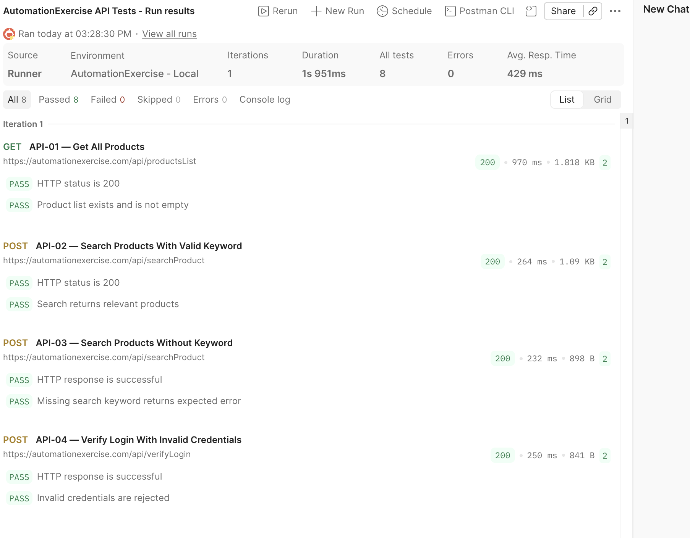

# Automation Exercise – Playwright Tests

## Overview

This project contains UI test automation for [Automation Exercise](https://automationexercise.com/) using Playwright and JavaScript.

The goal is to validate important user flows, including product search, cart operations, and login validation. The repository also includes API testing artifacts created with Postman.

## Tech Stack

- Playwright
- JavaScript
- Node.js and npm
- Postman
- GitHub Actions

## Project Structure

```text
automation-exercise-playwright-javascript/
├── .github/
│   └── workflows/
│       └── playwright.yml
├── api/
│   ├── collections/
│   │   └── collection.json
│   ├── environments/
│   │   └── environment.json
│   └── evidence/
│       └── postman-run.png
├── evidence/
│   └── controlled-failure.png
├── pages/
├── tests/
├── test-data/
├── playwright.config.js
├── package.json
├── package-lock.json
├── .gitignore
└── README.md
```

*Note: This structure shows the main project files and directories. Adjust it to match the actual repository.*

## Prerequisites

Make sure the following tools are installed:

- [Node.js](https://nodejs.org/) (LTS version recommended)
- [Git](https://git-scm.com/)

## Installation

### 1. Clone the Repository

```bash
git clone https://github.com/basakbilginoglu/automation-exercise-playwright-javascript.git
cd automation-exercise-playwright-javascript
```

### 2. Install Dependencies

Choose one of the following options.

**Option A:**

```bash
npm install
```

**Option B:**

```bash
npm ci
```

`npm ci` requires the committed `package-lock.json` file and installs dependencies according to the lockfile. It is suitable for clean and reproducible installations.

Use either `npm install` or `npm ci`; running both is not necessary.

### 3. Install Playwright Browsers

```bash
npx playwright install
```

## Running Tests

### Run All Tests

```bash
npx playwright test
```

### Run Tests with a Visible Browser

```bash
npx playwright test --headed
```

### Run Tests in Playwright UI Mode

```bash
npx playwright test --ui
```

### Run Tests in a Specific Browser

```bash
npx playwright test --project=chromium
npx playwright test --project=firefox
npx playwright test --project=webkit
```

### Run a Specific Test File

Replace the example path with the actual test file path:

```bash
npx playwright test tests/product-search.spec.js
```

### View the HTML Report

After running the tests:

```bash
npx playwright show-report
```

## Test Scope

### 1. Product Search

- Search for a product using the search field.
- Verify that the search results contain relevant product information.

### 2. Cart

- Add a product to the cart.
- Verify the product name and price in the cart.
- Verify that the product quantity is one.

### 3. Negative Login

- Attempt to log in using invalid credentials.
- Verify that the expected error message is displayed.

## Design Decisions

- **Page Object Model (POM):** Page-specific interactions are organized into page classes to improve maintainability and reusability.
- **Business-critical assertions:** The cart test checks the product name, price, and quantity.
- **Negative testing:** The login test verifies the application's response to invalid credentials.
- **Cross-browser configuration:** Playwright is configured to support Chromium, Firefox, and WebKit, if these projects are present in the configuration.
- **Separation of concerns:** Tests, page objects, test data, and API-related files are organized separately.
- **CI integration:** GitHub Actions runs the test suite according to the configured workflow triggers and supports manual execution.

## CI Integration and Failure Analysis

GitHub Actions executes the Playwright test suite in a CI environment. The workflow runs on pushes and pull requests targeting the configured `main` and `master` branches and supports manual execution through `workflow_dispatch`.

### 1. Successful CI Runs

Successful CI runs help verify that the corrected test suite executes as expected.

- **Successful Run 1:** [View GitHub Actions Run](https://github.com/basakbilginoglu/automation-exercise-playwright-javascript/actions/runs/39236673697)
- **Successful Run 2:** [View GitHub Actions Run](https://github.com/basakbilginoglu/automation-exercise-playwright-javascript/actions/runs/39241089536)

## Locator Improvement and Test Verification

### Product-Specific Locator

I replaced `.first()` with a product-specific locator to make the test more reliable.

The `.first()` method selects the first matching element, which may not correspond to the intended product. Locating the intended product by name helps ensure that its title and price are checked.

**Code diff:** [View locator improvement commit](https://github.com/basakbilginoglu/automation-exercise-playwright-javascript/commit/02825fa14a62ace4e56cb5481bf48426b205a534)

### Cart Quantity Assertion

I added a quantity assertion to verify that the product was added to the cart with a quantity of one.

**Code diff:** [View quantity assertion commit](https://github.com/basakbilginoglu/automation-exercise-playwright-javascript/commit/e95a55bedfee806e701c483742ea8bb957bfcd74)

## Postman API Testing Evidence

The Postman collection was executed using Collection Runner.

**Postman execution screenshot:**



### API Response Validation

Both HTTP status codes and response bodies are validated in Postman tests.

- **Status code validation:** Checks whether the API returns the expected HTTP status.
- **Response body validation:** Checks whether the returned data or error message meets expectations.

Using both validations helps detect incorrect API behavior and reduces the risk of false-positive test results.